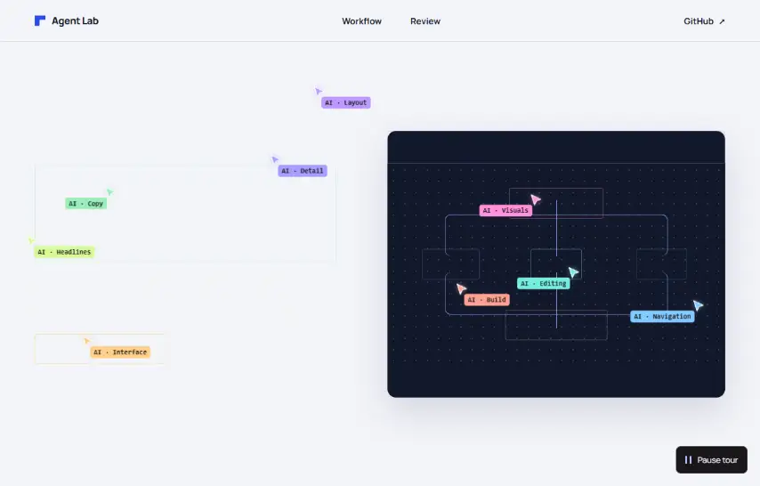

# Site Assembly

**Install once. Give your agent a URL. Watch nine cursors assemble the page.**

Site Assembly is a Codex skill that turns a real website into a motion demo. Cursor teams lay out visuals, type copy letter by letter, and reveal controls as the page scrolls. Try it on your own project or on a public site you can open in a browser.

[Watch Agent Lab live](https://wquxss.github.io/site-assembly/demo/) · [Русская версия](README.ru.md) · [Read the skill](skills/site-assembly/SKILL.md)



## Install in Codex

Paste this message into Codex:

```text
Use $skill-installer to install Site Assembly from https://github.com/wquxss/site-assembly/tree/main/skills/site-assembly
```

Prefer a terminal?

```sh
npx skills add https://github.com/wquxss/site-assembly --skill site-assembly
```

Select Codex if prompted. Once installed, run:

```text
$site-assembly https://example.com/
```

The link is the input. Codex inspects the page and returns a preview or a browser overlay with launch instructions. The skill is a workflow for your coding agent, so preparing a new site takes an agent run.

## What happens to the site?

| What you have | What Site Assembly does |
| --- | --- |
| A verified local checkout | Adds the tour at the normal page entry point and verifies it locally. |
| Verified public files you have permission to reuse | Uses those files if they reproduce the published result. |
| A third-party URL | Uses an isolated Chromium overlay on the live page. It reveals existing elements in place and leaves the site's scripts and navigation in charge. |

The overlay is scoped to the requested URL. Some sites need an adapter for custom layouts or dynamic routes. If the page itself is inaccessible or important content lives inside a cross-origin frame, the agent reports what it could verify. Deployment is a separate step.

## Try the sample locally

Requires Node.js. Run `node scripts/serve.mjs` from the repository, then open `http://127.0.0.1:4183/demo/`.

Agent Lab is an original fictional interface. Its nine cursor roles are browser simulations. The runtime uses no API key and makes no model calls. The page supports Escape to pause, replay, anchor links, and reduced motion. Open an [issue](https://github.com/wquxss/site-assembly/issues/new) with the route and expected behavior if a tour gets stuck.

## Credits

[shinedsgn.ru](https://shinedsgn.ru/) · [t.me/shinecode](https://t.me/shinecode)

[MIT](LICENSE) for the skill, runtime and demo code. The demo’s Manrope font is distributed under the [SIL Open Font License](demo/manrope-OFL.txt).
