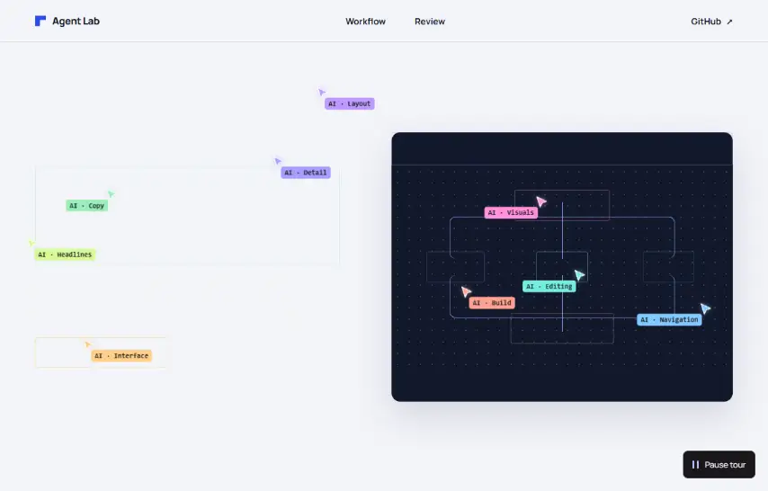

# Site Assembly

**Установи один раз. Дай агенту ссылку. Смотри, как девять курсоров собирают страницу.**

Site Assembly превращает сайт в моушн-демо. Курсоры выкладывают визуальные блоки, печатают текст по буквам и раскрывают кнопки, пока страница прокручивается. Попробуй на своём проекте или на публичном сайте, который открывается в браузере.

[Открыть Agent Lab](https://wquxss.github.io/site-assembly/demo/) · [English](README.md) · [Инструкции навыка](skills/site-assembly/SKILL.md)



## Установка в Codex

Вставь в чат:

```text
Установи через $skill-installer навык Site Assembly из https://github.com/wquxss/site-assembly/tree/main/skills/site-assembly
```

Или запусти в терминале:

```sh
npx skills add https://github.com/wquxss/site-assembly --skill site-assembly
```

Если появится выбор клиента, выбери Codex. После установки передавай ссылку так:

```text
$site-assembly https://example.com/
```

Codex изучит страницу и подготовит превью или наложение с инструкцией запуска. На подготовку нового сайта нужен отдельный запуск агента.

## Как навык работает с сайтом

| Что доступно | Что произойдёт |
| --- | --- |
| Проверенные локальные исходники | Тур подключится к обычной точке входа проекта и пройдёт локальную проверку. |
| Проверяемые публичные файлы с правом использования | Навык соберёт превью из них, если они воспроизводят опубликованный результат. |
| Сторонний URL | Наложение Chromium покажет курсоры и маски поверх живой страницы. Разметка, навигация и формы останутся у сайта. |

Наложение действует на заданный URL. Сложные сетки и динамические маршруты могут потребовать адаптера. Если страница недоступна или важный блок находится в iframe другого домена, агент сообщит, что удалось проверить. Публикация сайта запускается отдельно.

## Локальное демо

Нужен Node.js. Запусти `node scripts/serve.mjs` из папки репозитория и открой `http://127.0.0.1:4183/demo/`.

Agent Lab — вымышленный интерфейс. Роли курсоров симулируются в браузере. Тур работает без ключей API и вызовов моделей. У него есть пауза по Escape, повтор, переходы по якорям и поддержка уменьшенного движения.

## Авторство

[shinedsgn.ru](https://shinedsgn.ru/) · [t.me/shinecode](https://t.me/shinecode)

[MIT](LICENSE) для навыка, анимации и кода демо. Шрифт Manrope распространяется по [SIL Open Font License](demo/manrope-OFL.txt).
